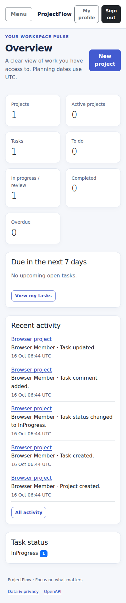

# ProjectFlow

A full-stack project and task workspace built by Sabekunnaher Antora with ASP.NET
Core MVC, a same-origin Web API, Identity, EF Core and SQL Server.

## Features

- Registration, login/logout, profile editing, account lockout, IP limits and secure sessions.
- Organizations, member directories, scoped projects, managers, dates and archiving.
- Tasks with eligible assignees, priorities, controlled transitions, My Tasks,
  combined filters, stable pagination, table and Kanban views.
- Database-driven dashboard counts, deadlines, activity history and task discussion.
- Private in-app assignment/status/comment notifications, read state and idempotent
  deadline reminders; no external email dependency.
- Protected account activation and role administration, including last-admin and
  concurrent-demotion protection.
- Filtered CSV reports with formula escaping; responsive, keyboard-accessible forms.
- Versioned JSON contracts, development OpenAPI, SQL migrations and automated CI.

## Architecture

```text
src/ProjectFlow.Core            Entities, enums, DTOs, actor contract, domain rules
src/ProjectFlow.Infrastructure  EF/Identity SQL storage and shared business services
src/ProjectFlow.Web             Razor MVC + /api/v1 in one authenticated host
tests/ProjectFlow.UnitTests     Pure rules and CSV security regressions
tests/ProjectFlow.IntegrationTests  HTTP, SQL constraints/races and Chromium journey
```

The Web host shares authorization and services between MVC and API. Production
storage is SQL Server; SQLite exists only as an isolated in-memory test provider.
The supplied two-page PDF and implementation decisions are described in
[ARCHITECTURE](docs/ARCHITECTURE.md).

## Prerequisites

- .NET SDK **10.0.402** (`global.json`), Git and an approved **SQL Server 2022+** instance.
- An operator with permission to create a **new dedicated development database**
  and apply migrations. Normal app credentials should have only that database's
  required data permissions, not server-wide administration.
- SQL TLS/certificate configuration appropriate to the environment. This repository
  does not install SQL Server, modify Windows services or change certificate trust.

If using a portable SDK, invoke its `dotnet` executable or add its directory to
the **current terminal process** only. An IDE is optional.

## Clone, configure and run

```powershell
git clone https://github.com/sabekunnaher-17/ProjectFlow.git
cd ProjectFlow
dotnet restore --locked-mode
dotnet build --no-restore
dotnet tool restore

$env:ASPNETCORE_ENVIRONMENT = "Development"
$secureConnection = Read-Host "SQL connection targeting a NEW dedicated database" -AsSecureString
$env:ConnectionStrings__DefaultConnection = [System.Net.NetworkCredential]::new("", $secureConnection).Password

# Review the server/database target first. Do not target existing or production data.
dotnet ef database update --project src/ProjectFlow.Infrastructure --startup-project src/ProjectFlow.Infrastructure
dotnet run --project src/ProjectFlow.Web --no-launch-profile --urls http://localhost:5080
```

Open [localhost:5080](http://localhost:5080). Register a new account and sign in.
There is no seeded password, sample production database or automatic administrator.
Create an organization, add teammates by their registered emails, and create a project.

Use process environment settings or the Web project's configured User Secrets store
for local credentials. `appsettings.Example.json` is a **placeholder reference**, not
an automatically loaded file. Do not copy credentials into tracked appsettings.
The EF design-time factory reads the process connection setting; User Secrets alone
do not configure migration commands. With no explicit connection, database-update
commands fail closed. For offline SQL generation only:

```powershell
New-Item -ItemType Directory -Path artifacts -Force | Out-Null
dotnet ef migrations script 0 InitialSchema --idempotent --project src/ProjectFlow.Infrastructure --startup-project src/ProjectFlow.Infrastructure --output artifacts/initial-schema.sql -- --design-only
```

The explicit design-only mode uses a reserved invalid host and never selects LocalDB.
The application does not auto-apply or recreate schemas at startup.

## First administrator and roles

Accounts begin as **Team Member**. Other supported roles are **Project Manager** and
**Admin**. Organization owners manage their workspace; project-manager assignment
is scoped and never opens unrelated projects. To promote an existing active account
when no administrator exists, stop the local app and run:

```powershell
$env:Bootstrap__Email = Read-Host "Existing account email to bootstrap as Admin"
dotnet run --project src/ProjectFlow.Web --no-launch-profile -- --bootstrap-admin
Remove-Item Env:Bootstrap__Email
```

Reuse the process database connection from setup. Bootstrap refuses if an Admin
already exists. Sign in again afterward. Subsequent changes use the protected
Administration screen; role/deactivation changes invalidate existing sessions.

## Verification and CI

```powershell
dotnet restore --locked-mode
dotnet build --no-restore
dotnet test --no-build
dotnet format whitespace ProjectFlow.sln --verify-no-changes --no-restore --exclude src/ProjectFlow.Infrastructure/Data/Migrations
dotnet list ProjectFlow.sln package --vulnerable --include-transitive
```

Local tests do not require SQL Server. SQL-only constraints/races and the real
browser journey explicitly skip without their required environment. They are
mandatory in the isolated **SQL Server CI job**, which generates credentials,
creates fresh uniquely named `_test` databases, applies migrations and removes only
its disposable runner container afterward. Security scans full Git history;
transitive NuGet auditing fails restore on vulnerability warnings. See
[TESTING](docs/TESTING.md) for coverage, counts, limitations and exact configuration.

## API and documentation

- JSON API: `/api/v1`; cookie authentication plus `X-CSRF-TOKEN` on mutations.
- Development OpenAPI: `/openapi/v1.json` (not exposed in production).
- [API contracts](docs/API_DOCUMENTATION.md) · [schema diagram](docs/DATABASE_SCHEMA.md)
  · [security](docs/SECURITY.md) · [roadmap](docs/DEVELOPMENT_ROADMAP.md)
  · [setup/deployment notes](docs/SETUP.md).

## Screenshots

Actual Chromium screenshots from the passing SQL CI browser fixture at `e8229b9`.
Names/counts are test data created through the UI, not production users or fabricated metrics.


<details><summary>Mobile dashboard</summary>



</details>

## Current limits

No local SQL Server was installed or migrated on the development PC; SQL verification
uses isolated CI. No production deployment or manual UI testing is claimed. Browser
automation currently covers Chromium, not Firefox/WebKit or a formal accessibility
audit. Email confirmation/recovery, attachments and comment deletion are not provided.
Deadline checks run every five minutes. CSV exports are capped at 5,000 matching rows
with an explicit error for larger reports; organization listings show up to 100 workspaces.
Production needs TLS, protected persistent Data Protection keys, backups and approved
database credentials. Multi-host public deployments should add shared edge rate limits.
