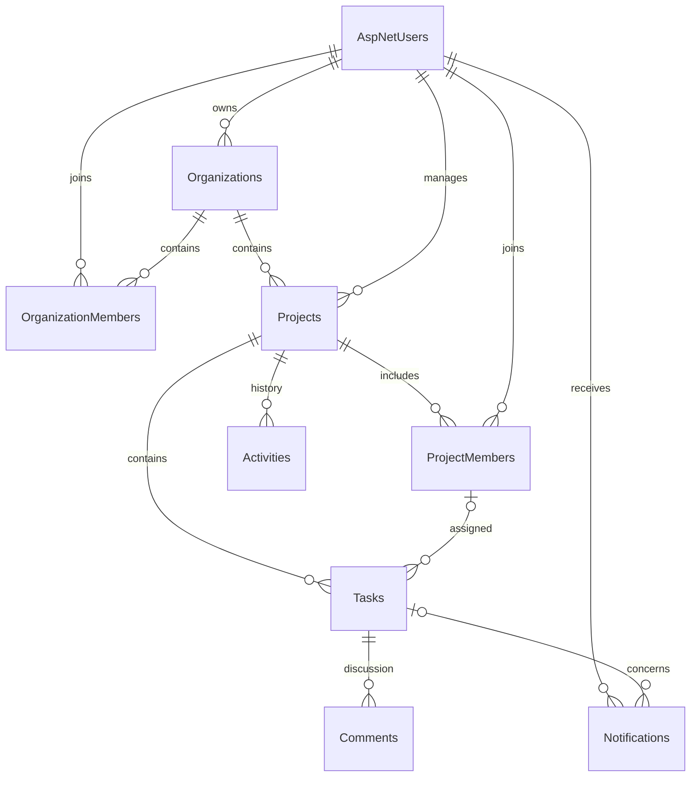

# Database schema

SQL Server with EF Core's `InitialSchema` migration, generated, reviewed and applied
from scratch in isolated SQL Server 2022 CI. No local SQL Server database was created
or migrated. SQL tests also enforce the assignment FK, date checks and notification
unique index with actual rejected writes. The model has no pending migration changes.

- Identity's seven standard tables store users, roles and framework claims/tokens.
  ApplicationUser adds DisplayName (100), IsActive and CreatedAt. IDs and composite
  login/token key parts are bounded to 128 characters for SQL Server key limits.
- Organizations: GUID ID, Name (120), OwnerId; unique OrganizationMember pair.
- Projects: GUID ID, OrganizationId, Name (120), Description (3000), ManagerId,
  StartDate/EndDate, Status. Unique ProjectMember pair. Manager/organization membership
  is additionally validated by application services.
- Tasks: GUID ID, ProjectId, Title (160), Description (5000), nullable AssigneeId,
  Priority, Status, StartDate, DueDate, nullable CompletedAt. Composite foreign key
  (ProjectId, AssigneeId) enforces project membership for assigned users.
- Comments: task/author, Body (3000), timestamps/concurrency. Activities: project,
  optional task, actor, Description (500), timestamp. Restrictive foreign keys
  preserve history; resources will be archived rather than physically deleted.
- Notifications: recipient, optional task, Message (300), EventKey (180), CreatedAt,
  ReadAt. Unique (UserId, EventKey) prevents event duplication.

Organization/project/task/comment records have CreatedAt/UpdatedAt UTC offsets and
application-managed GUID Version concurrency tokens. Planning dates use SQL date
and DateOnly. Checks enforce valid project/task dates, status and priority ranges.
Services also enforce task dates inside their project interval. Query indexes
cover ownership, membership, scope/status, assignee/deadline and notification reads.

Task progress excludes Cancelled from the denominator; an empty active set yields
0%. Members may advance Todo → InProgress → InReview → Completed or return work to
an earlier active state. Cancellation and reopening completed/cancelled work require
management permission. Archived projects are read-only. These are documented choices
because the two-page PDF does not supply detailed schema or state-machine rules.
